# MacTahoe Tinted Glass 
  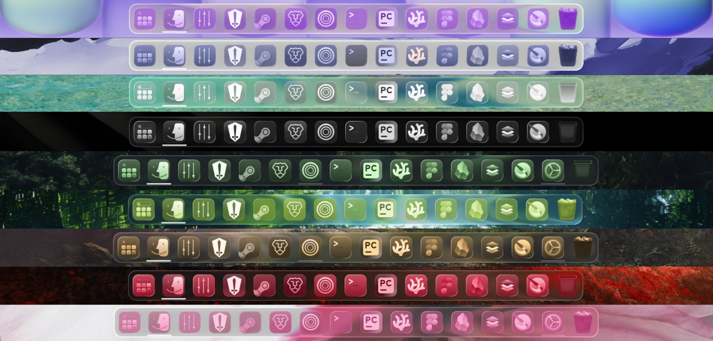


<div align="center">
  <a href="#-english">English</a> | <a href="#-español">Español</a>
</div>

---

<a name="-english"></a>
## 🇬🇧 English

An elegant translucent and tinted glass visual theme, inspired by the modern aesthetic of macOS Tahoe, designed to customize your desktop environment.

### Preview (Color Variants)

- **Liquid Glass:**
  
- **Grey Glass:**
  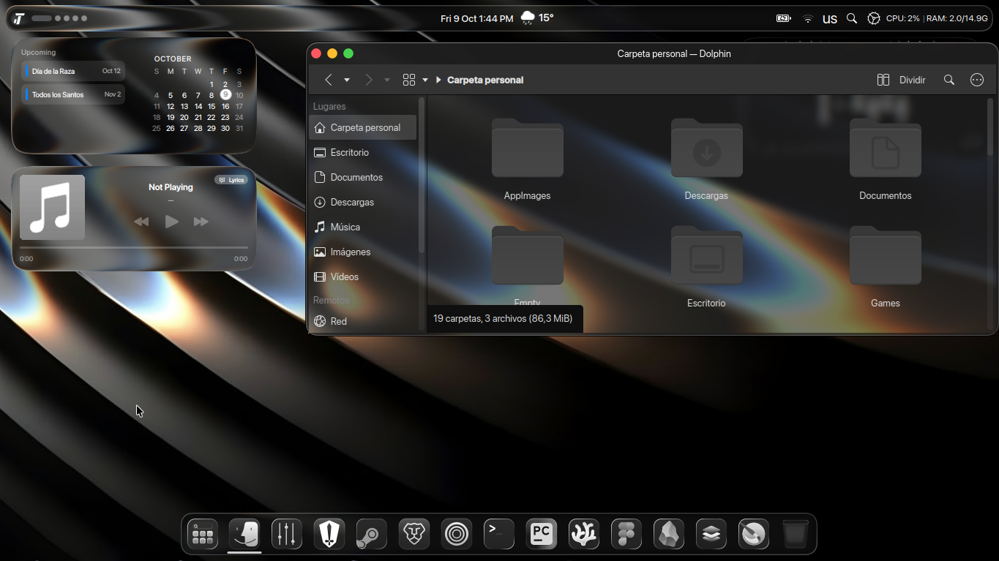
- **Azure Glass:**
  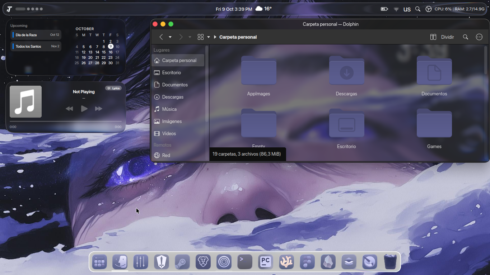
- **Carmesi Glass:**
  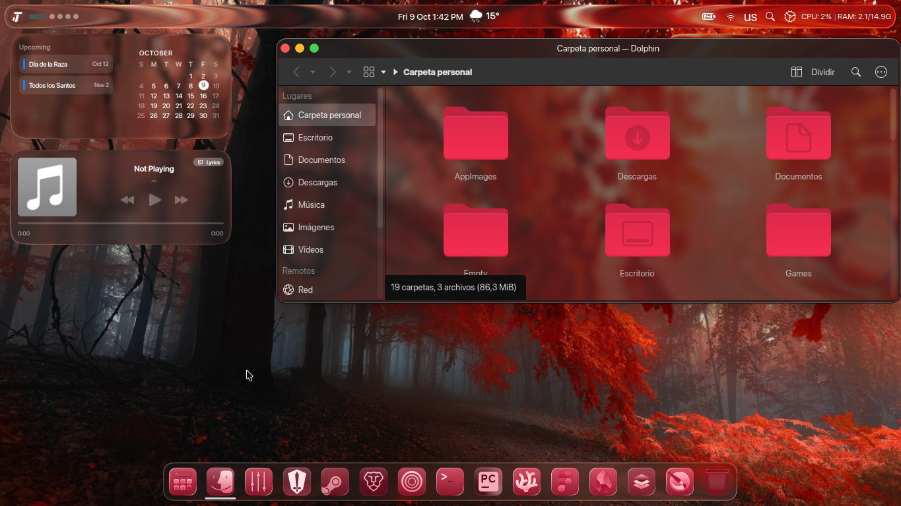
- **Olive Green Glass:**
  
- **Purple Glass:**
  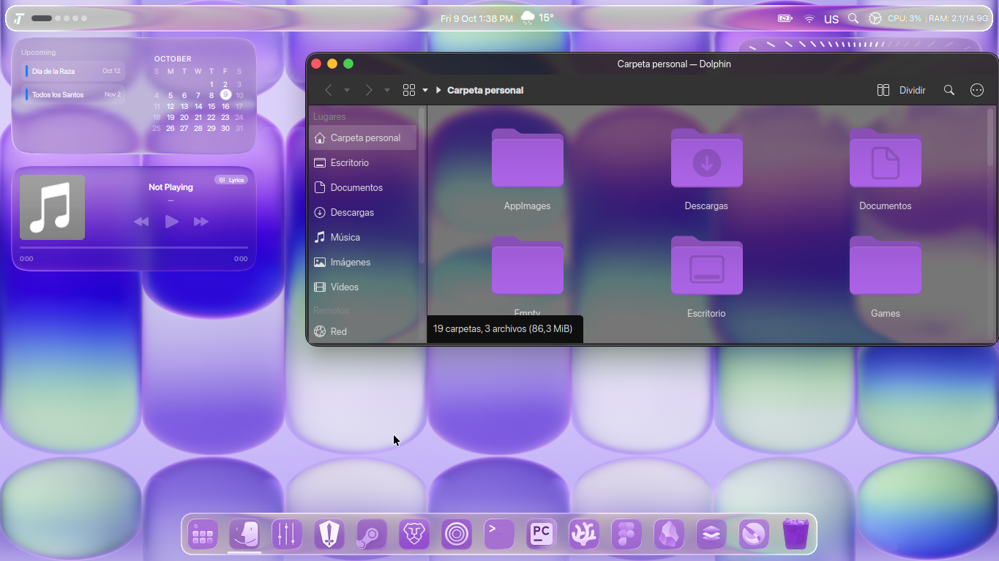
- **Pink Glass:**
  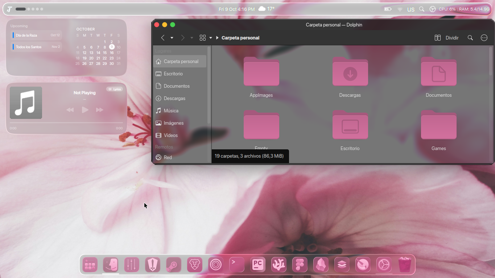
- **Edge Glass:**
  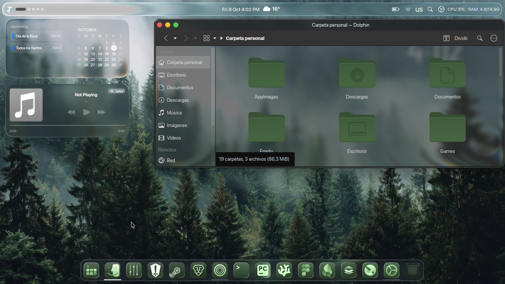
- **Land Glass:**
  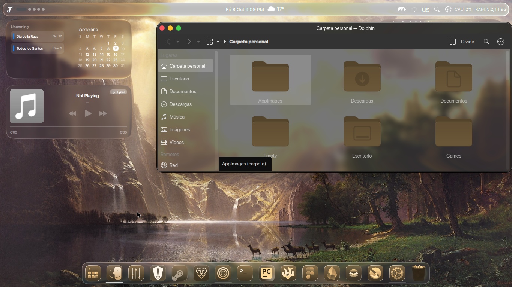

### Features
- **Glassmorphism Effect:** Subtle and elegant transparencies inspired by modern interfaces.
- **Multiple Color Variants:** Includes *Grey, Azure, Carmesi, Olive Green, Purple, Pink, Edge,* and *Land* options.

### Installation
1. Clone this repository or download the ZIP:
   ```bash
   git clone https://github.com/Johan-Ardila/MacTahoe-Tinted-Glass-Icons.git
2. Look for this option in your KDE Plasma icons section:
   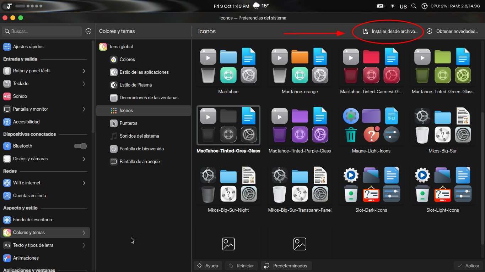
3. Finally, select the file, click open, and you're all set—it will be successfully installed:
   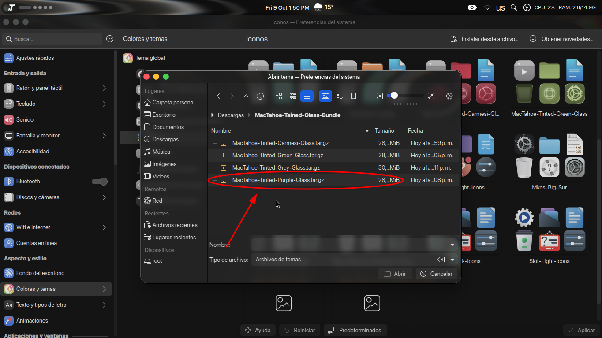

<a name="-english"></a>
## 🇪🇸 spanish

Un tema visual elegante de estilo translúcido y cristal tintado (*Tinted Glass*), inspirado en la estética moderna de macOS Tahoe, diseñado para personalizar tu entorno de escritorio.

##  Vista Previa (Variantes de Color)

- **Liquid Glass:**
  
- **Grey Glass:**
  
- **Azure Glass:**
  
- **Carmesí Glass:**
  
- **Olive Green Glass:**
  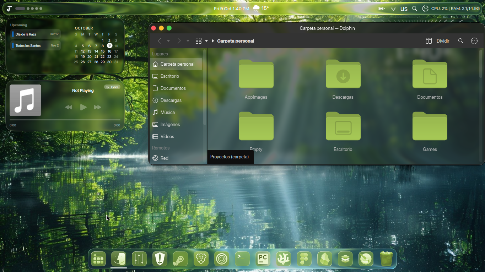
- **Purple Glass:**
 
- **Pink Glass:**
  
- **Edge Glass:**
  
- **Land Glass:**
  

## Características
- **Efecto Glassmorphism:** Transparencias sutiles y elegantes inspiradas en interfaces modernas.
- **Múltiples Variantes:** Incluye opciones en tonos *Grey, Azure, Carmesí, Olive Green, Purple, Pink, Edge* y *Land*.

## Instalación
1. Clona este repositorio o descarga el ZIP:
   ```bash
   git clone https://github.com/Johan-Ardila/MacTahoe-Tinted-Glass-Icons.git
 2.Busca esta opcion en tu seccion de iconos de KDE plasma:
  
  
 3.Y por último escoje el archivo y dale en abrir y listo ya lo tendrías instalado satisfactoriamente
  

